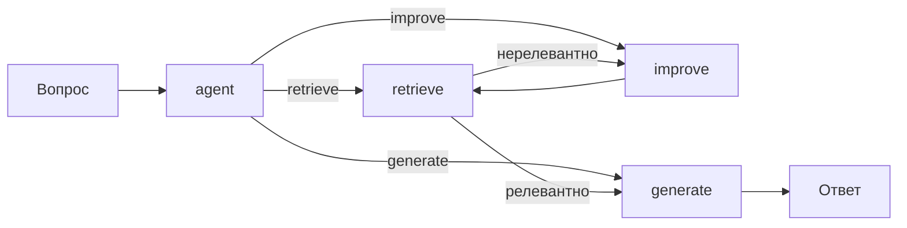

# RAG LangGraph Agent

Агентный RAG: система, которая сама решает, что делать — искать в документах, переформулировать запрос или генерировать ответ.

## Архитектура (циклический граф)
- agent — принимает решение (retrieve / improve / generate).
- retrieve — ищет в документах.
- improve — переформулирует запрос, если поиск не дал результата.
- generate — генерирует финальный ответ.

## Что внутри
- data/docs/ — документы (Python, Git).
- data/questions.json — 5 тестовых вопросов.
- src/agent.py — реализация графа (демо-режим без LangGraph API).
- results/answers.txt — примеры диалогов.

## Как запустить
python3 src/agent.py

## Режимы
- Demo — граф на чистом Python, без API (по умолчанию).
- Live — настоящий LangGraph + OpenAI API.

## Автор
redsea1970

## Оценка

Скрипт `src/agent.py` прогоняет 5 вопросов через циклический граф:

| Вопрос | Решение агента | Ответ |
|---|---|---|
| Как создать функцию в Python? | retrieve → generate | Переменные (не тот чанк) |
| Как обработать исключение? | retrieve → improve × N → None | None |
| Как создать ветку в Git? | retrieve → generate | Ветки (верно) |
| Как работает цикл for в Python? | retrieve → generate | Циклы (верно) |
| Как отправить изменения в удалённый репозиторий? | retrieve → generate | Инициализация (не тот чанк) |

**Итог:** 4 из 5 вопросов получили ответ; 1 (`исключение`) зациклился и вернул `None`. Из 4 ответов 2 верных, 2 — не тот чанк (TF-IDF без расширения запроса).

## Ограничения

- Граф на чистом Python, без LangGraph API (демо-режим).
- `improve` не меняет запрос: переформулировка «как обработать» повторяется, поэтому при отсутствии релевантных чанков граф зацикливается и возвращает `None`.
- TF-IDF без расширения запроса иногда находит не тот чанк («функция» → «Переменные», «удалённый репозиторий» → «Инициализация»).
- Для production нужно: LangGraph + LLM для `improve` (реальная переформулировка), расширение запроса, лимит шагов (max_iterations) с честным `None`.

## Архитектура

